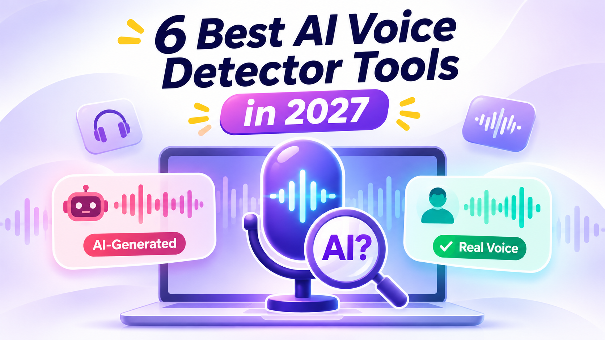

# 6 Best AI Voice Detector Tools in 2027

AI voice detector tools help identify whether a voice recording is spoken by a real person or generated using artificial intelligence. They are useful for checking voice notes, interviews, podcasts, videos, and suspicious phone recordings.

AI-generated voices are becoming more realistic every year. Some can copy a person's tone, accent, and speaking style, making it difficult to identify fake audio by listening alone.

In this guide, we compare 6 AI voice detector tools in 2027. You will find their features, pros, cons, pricing, and best uses to help you choose the right option.

## Quick Comparison of 6 AI Voice Detector Tools

| Tool | Best For | Pricing |
|---|---|---|
| Reality Defender | Deepfake audio detection | Business pricing |
| Resemble Detect | Developers and businesses | Usage-based |
| ElevenLabs Audio Detector | Checking ElevenLabs audio | Free |
| Hiya | Voice security and suspicious calls | Free options; business plans |
| Hive AI Detection | Large-scale audio moderation | Demo; business pricing |
| DeepFake-O-Meter | Research and multiple detection models | Free |

### 🎙️ [Identify AI-Generated Voices →](https://www.yttags.com/7-best-ai-voice-detectors/)

## 1. Reality Defender

**Best For:** Detecting AI-generated voices and deepfake audio.

Reality Defender is an AI detection platform that checks audio, images, and videos for signs of manipulation. Its audio detection feature helps identify synthetic speech and cloned voices.

The platform is designed for organizations that need to check suspicious recordings and reduce the risk of voice-based fraud.

**Key Features:**
- Detects AI-generated and manipulated audio.
- Supports image and video deepfake detection.
- Provides detection results through its platform and API.
- Offers tools for business and security workflows.
- Supports different media verification needs.

**Pros:**
- Supports multiple media types.
- Useful for security and fraud prevention.
- Offers API-based integration.
- Designed for professional workflows.

**Cons:**
- Advanced features are aimed at businesses.
- Results may vary with audio quality.
- Not every user needs its enterprise features.

**Pricing:**
- Free access: Limited scanning options may be available.
- Paid plans: Contact Reality Defender for current pricing.
- Enterprise pricing depends on usage and requirements.

**Review:** Reality Defender is a useful choice for organizations that need more than a basic audio checker. Its support for multiple media types makes it suitable for broader deepfake detection work.

### 🎬 [Verify Videos with AI Detectors →](https://www.yttags.com/ai-video-detectors/)

## 2. Resemble Detect

**Best For:** AI voice detection and developer integrations.

Resemble Detect is a detection solution from Resemble AI. It analyzes audio and other media to identify possible signs of AI manipulation.

It is especially useful for developers and companies that want to add deepfake detection to their applications, platforms, or security systems.

**Key Features:**
- Detects synthetic and manipulated audio.
- Supports audio, image, and video analysis.
- Provides API access for integrations.
- Offers detection capabilities for business workflows.
- Returns results that can help identify possible manipulation.

**Pros:**
- Suitable for developers.
- Supports different media formats.
- Useful for automated detection workflows.
- Offers API integration.

**Cons:**
- More technical than simple upload tools.
- Usage costs can increase with audio volume.
- Not designed mainly for casual users.

**Pricing:**
- Usage-based pricing is available.
- Costs depend on the selected service and volume.
- Contact Resemble AI for current business and integration rates.

**Review:** Resemble Detect is a strong option for businesses that process large amounts of audio. Its API makes it easier to include voice verification in an existing application or workflow.

### 🔍 [Find the Best AI Detection Tools →](https://www.yttags.com/ai-detectors/)

## 3. ElevenLabs Audio Detector

**Best For:** Checking whether audio was generated using ElevenLabs.

ElevenLabs provides an Audio Detector that checks for audio created using its voice-generation technology. It looks for supported audio watermarks and can use its older speech-classification method when appropriate.

This tool is helpful when you suspect a recording was created with ElevenLabs. However, it should not be treated as a universal AI voice detector.

**Key Features:**
- Checks supported ElevenLabs-generated audio.
- Uses watermark detection where available.
- Can use its legacy speech classifier when applicable.
- Works through an ElevenLabs account.
- Available without a separate detector subscription.

**Pros:**
- Free to access.
- Easy to use.
- Useful for checking supported ElevenLabs audio.
- Uses watermark technology where supported.

**Cons:**
- Does not identify every AI voice generator.
- Watermark detection only works with supported content.
- Older classifier coverage has limitations.

**Pricing:**
- Audio Detector: Free to access.
- No separate payment is required for the detector itself.
- Other ElevenLabs services may have their own subscription costs.

**Review:** ElevenLabs Audio Detector is a convenient choice when checking whether a clip came from ElevenLabs. For recordings created with other voice generators, use an additional detector.

### 🖼️ [Check If an Image Is AI-Generated →](https://www.yttags.com/ai-image-detector/)

## 4. Hiya

**Best For:** Checking suspicious voices and improving phone security.

Hiya develops voice security technology that helps identify suspicious and AI-generated speech. Its consumer-facing options include browser and phone-related protection features.

The browser extension can help users check audio in supported online content. Its phone-focused technology is designed to help identify potential deepfake calls.

**Key Features:**
- Offers browser-based audio checking options.
- Helps identify possible synthetic voices.
- Provides phone-focused deepfake protection technology.
- Supports broader voice security solutions.
- Useful for checking suspicious online recordings.

**Pros:**
- Consumer-friendly options are available.
- Useful for browser audio checks.
- Focuses on voice-related threats.
- Can support phone security workflows.

**Cons:**
- Browser checking is not the same as uploading any audio file.
- Availability may vary by device and region.
- Some business features require commercial integration.

**Pricing:**
- Browser extension: Free option available.
- Phone protection: Check current app availability and plan details.
- Business services: Contact Hiya for pricing.

**Review:** Hiya is worth considering if you regularly encounter suspicious audio online or want additional protection against voice-based scams. Check the supported device and browser requirements before using it.

### 🔍 [Find the Best AI Detection Tools →](https://www.yttags.com/ai-detectors/)

## 5. Hive AI Detection

**Best For:** Businesses and platforms that need to scan audio at scale.

Hive offers AI-generated content detection for different media types, including audio. Its tools can help platforms identify synthetic speech and potentially manipulated recordings.

Hive is mainly useful for businesses, developers, and content moderation teams that need automated media checks.

**Key Features:**
- Detects AI-generated audio.
- Supports image and video detection.
- Offers API integration.
- Provides detection tools and demonstrations.
- Helps with large-scale content moderation.

**Pros:**
- Supports multiple media formats.
- Useful for automated workflows.
- Suitable for platforms and businesses.
- Offers developer-focused solutions.

**Cons:**
- API setup may require technical knowledge.
- Advanced usage may involve business pricing.
- Detection results are not guaranteed proof of authenticity.

**Pricing:**
- Demo: Free detection options may be available.
- API: Pricing depends on usage and selected services.
- Enterprise: Contact Hive for a custom quote.

**Review:** Hive is a practical option for companies that need to check large volumes of uploaded media. It is less suitable for someone who only wants to inspect one short voice recording occasionally.

### 📈 [Boost Your YouTube Views →](https://www.yttags.com/best-sites-to-buy-youtube-views/)

## 6. DeepFake-O-Meter

**Best For:** Research and comparing results from multiple detection models.

DeepFake-O-Meter is a research-focused platform that helps users analyze suspected manipulated media. It provides access to multiple deepfake detection models, allowing users to compare their results.

This makes it useful for researchers, journalists, students, and people who want a second opinion on suspicious audio.

**Key Features:**
- Provides access to multiple detection models.
- Helps analyze suspected deepfake audio.
- Allows comparison of different model results.
- Supports research and media verification.
- Offers a web-based platform.

**Pros:**
- Free research-focused access.
- Multiple models provide different perspectives.
- Useful for testing and comparison.
- Helpful for academic research.

**Cons:**
- Results may differ between models.
- Requires some understanding of detection results.
- Not designed for live phone-call protection.

**Pricing:**
- Web platform: Free access is available.
- Account: Registration may be required.
- Research use: Check the platform for current access conditions.

**Review:** DeepFake-O-Meter is a useful option when you want to compare multiple detection results instead of relying on one score. It is particularly helpful for research and detailed audio investigation.

### 📄 [Check PDF Documents for Fraud →](https://www.yttags.com/fake-pdf-detector/)

### Key Differences Between Human and AI-Generated Voices

| Feature | Human Voice | AI-Generated Voice |
|---|---|---|
| Speech Rhythm | Natural pauses and variations | May sound more consistent |
| Emotion | Spontaneous emotional changes | Emotions may sound less natural |
| Pronunciation | Natural accents and speaking habits | May have unusual word pronunciation |
| Breathing | Natural breathing sounds | Breathing may be missing or generated |
| Voice Variation | Pitch and tone change naturally | Some voices may sound more uniform |

These differences are only clues. Modern AI voices can sound very realistic, and human recordings can sometimes sound robotic. Use an AI voice detector for additional analysis rather than relying only on listening.

### 🧾 [Spot Fake Receipts Online →](https://www.yttags.com/5-best-fake-receipt-detectors/)

## How Does an AI Voice Detector Work?

An AI voice detector analyzes audio signals to estimate whether speech is human-recorded or artificially generated.

It looks for patterns that may be difficult for voice-generation systems to reproduce naturally.

Common detection methods include:

1. **Audio Pattern Analysis:** Checks sound patterns and frequency details.
2. **Speech Rhythm:** Examines pauses, timing, and speaking patterns.
3. **Voice Characteristics:** Studies pitch, tone, and changes in vocal expression.
4. **Synthetic Audio Signals:** Looks for patterns associated with AI-generated speech.
5. **Watermark Detection:** Checks for supported signals embedded by certain AI voice generators.

After analyzing the recording, the tool may provide a result, probability score, or confidence estimate.

## Benefits of Using AI Voice Detector Tools

AI voice detectors can help people make better decisions when checking suspicious recordings.

Some important benefits include:

- **Detect Fake Voices:** Identify recordings that may contain AI-generated speech.
- **Reduce Voice Scams:** Help investigate suspicious calls and voice messages.
- **Verify Online Content:** Check audio used in videos, podcasts, and social media.
- **Support Research:** Help researchers study synthetic speech and deepfake technology.
- **Protect Businesses:** Add another layer of checking to customer support and security workflows.
- **Save Time:** Analyze audio faster than manually investigating every recording.

### 🪪 [Verify ID Documents for Authenticity →](https://www.yttags.com/fake-id-detector/)

## How to Choose the Best AI Voice Detector

Choosing the right detector depends on the type of audio you want to check and how often you use it.

Consider these points before selecting a tool:

- **Accuracy:** Look for independent testing and clear information about detection limitations.
- **Audio Support:** Check whether the tool accepts MP3, WAV, or other required formats.
- **Detection Type:** Some tools check uploaded recordings, while others monitor live calls or browser audio.
- **Pricing:** Compare free access, monthly plans, and usage-based charges.
- **Privacy:** Review how the provider stores, processes, and protects uploaded recordings.
- **Ease of Use:** Choose a simple upload tool if you do not need an API or business integration.

You can also explore the [YTTags Tool](https://sites.google.com/view/yttags-tool) for additional online tools and resources.

For another type of AI-generated media verification, see our guide to [7 Best AI Image Detector Tools](https://github.com/7-Best-AI-Image-Detector-Tools-in-2027). You can also explore the [AI Photo Editor collection](https://github.com/best-AI-Photo-Editor) to learn about AI-powered image editing tools.

## AI Voice Detector vs. AI Speech Recognition

AI voice detection and speech recognition are two different technologies.

| Feature | AI Voice Detector | Speech Recognition |
|---|---|---|
| Main Purpose | Checks whether audio may be AI-generated | Converts speech into text |
| Input | Audio recordings or live audio | Spoken audio |
| Output | Detection result or confidence score | Written transcript |
| Common Use | Deepfake and voice verification | Transcription and captions |
| Main Focus | Audio authenticity | Spoken words |

A speech recognition tool can understand what someone says, but it does not automatically confirm whether the speaker is human or AI-generated.

## Are AI Voice Detectors 100% Accurate?

No AI voice detector can guarantee perfect accuracy. Detection results depend on audio quality, recording conditions, editing, and the AI model used to generate the voice.

Some tools may incorrectly flag a real human recording, while others may fail to identify synthetic speech. New voice-generation systems can also make detection more difficult.

For a broader look at AI detection tools, read this [AI Detector Tools Honest Review](https://github.com/10-Best-AI-Detector-Tools-Honest-Review).

For important decisions, compare results from more than one detector and verify the recording through a trusted source. Do not rely only on an automated score to confirm someone's identity.

## Limitations of AI Voice Detector Tools

AI voice detectors are useful, but they are not perfect. Their results can change depending on the recording and the AI model used to generate the voice.

Important limitations include:

- **Background Noise:** Traffic, music, and other sounds can affect detection.
- **Audio Compression:** Low-quality recordings may reduce detection performance.
- **New AI Models:** Some new voice generators may not be recognized immediately.
- **Edited Recordings:** Effects and filters can change the original audio signals.
- **False Results:** A real voice may be flagged as AI-generated, or synthetic speech may go undetected.

## Frequently Asked Questions

**1. What is an AI voice detector?**

An AI voice detector is a tool that analyzes audio to estimate whether speech was recorded by a human or generated using artificial intelligence.

**2. Can AI voice detectors identify cloned voices?**

Yes. Some tools are designed to detect cloned voices and synthetic speech. However, results depend on audio quality and the voice-generation technology used.

**3. Are AI voice detector tools free?**

Some tools offer free access or limited scans. Others provide paid API services and custom business plans.

**4. Which is the best AI voice detector in 2026?**

Reality Defender and Resemble Detect are useful for broader detection workflows. ElevenLabs Audio Detector is helpful for checking supported ElevenLabs audio, while DeepFake-O-Meter is useful for research.

**5. Can an AI voice detector check phone recordings?**

Some tools can analyze uploaded phone recordings, while others focus on live calls or browser audio. Check the supported input method before choosing one.

**6. Are AI voice detector results always accurate?**

No. Detection tools can make mistakes, especially with noisy, compressed, or heavily edited recordings. Use multiple checks for important situations.

## Final Thoughts

AI voice detector tools are becoming important as voice cloning and synthetic speech continue to improve. They can help users check suspicious recordings, investigate possible deepfakes, and reduce the risk of voice-based scams.

Reality Defender, Resemble Detect, ElevenLabs Audio Detector, Hiya, Hive, and DeepFake-O-Meter each serve different needs. Compare their features, pricing, and supported audio types before choosing one.

Remember that no AI voice detector can guarantee a perfect result. Use detection scores as guidance and verify important recordings through trusted sources.
